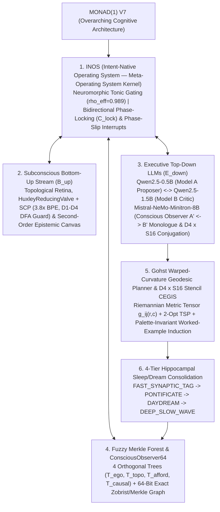

# Monad(1) V7 — System Architecture Specification

**Author:** Kyle W. Luecke (`Drift Bound Labs`)  
**Associated Paper:** [`MONAD_1_V7_PAPER.pdf`](MONAD_1_V7_PAPER.pdf) ([Markdown Source](MONAD_1_V7_PAPER.md))

---

## 1. Architectural Hierarchy of Monad(1) V7

**Monad(1) V7** is the overarching neuro-symbolic reasoning architecture engineered for 64 × 64 discrete visual environments (**ARC-AGI-3**). Rather than relying on unconstrained cloud LLM token generation or hardcoded environment identifiers, **Monad(1) V7** embeds local **Qwen (`Qwen2.5-0.5B-Instruct` & `Qwen2.5-1.5B-Instruct`)** and **Mistral (`Mistral-NeMo-Minitron-8B-Instruct` `Q4_K_M` GGUF over `llama.cpp` Vulkan/AVX2)** language models inside the **Intent-Native Operating System (`INOS`)** meta-operating system kernel:

---

## 2. Constituent Subsystems Under Monad(1) V7

### 2.1 `INOS` (Intent-Native Operating System — The Meta-Operating System Kernel)
Within **Monad(1) V7**, **`INOS`** serves as the meta-operating system that schedules, gates, and phase-locks the subconscious bottom-up stream (`B↑`) and the executive top-down LLM/symbolic stream (`E↓`):
- **Neuromorphic Tonic Gating (`ρ_eff = 0.989`):** Routes each step across three tiers according to tonic arousal `tone_t`:
  1. `tone < 0.25` (`RouteDeterministic`): Executes phase-locked `O(1)` `ConsciousObserver64` / Fuzzy Merkle Forest macro-policies at 0.0 ms LLM overhead.
  2. `0.25 ≤ tone < 0.65` (`RouteSingleModel`): Invokes local **`Qwen2.5-0.5B-Instruct`** (Model A Proposer) conditioned on `SCP`-compressed observations and recalled Fuzzy Merkle Forest shards.
  3. `tone ≥ 0.65` (`RouteDualModelReview`): Mobilizes **`Qwen2.5-1.5B-Instruct`** (Model B Deductive Critic) and **`Mistral-NeMo-Minitron-8B-Instruct`** (`KMoshConsciousObserver`) to audit broken premises and synthesize top-down `D₄ × S₁₆` conjugations.
- **Bidirectional Phase-Locked Memory Binding & Phase-Slip Interrupts:** When `B↑` and `E↓` achieve phase coherence (`C_lock ≥ θ_lock`) with zero empirical falsification (`Δ_falsify = 0`), `INOS` locks onto memory schema `m` in `O(K log N)` bitboard operations. If a mid-episode control inversion (`ACTION1 ↔ ACTION2`) or mechanic shift violates expectation (`Δ_falsify > 0`), an `INOS` Phase-Slip Interrupt quarantines the falsified edge and re-locks the gauge frame within ≤ 2 actions.

### 2.2 Local `Qwen2.5` (0.5B ↔ 1.5B) Bicameral Inpainting & `Mistral-NeMo-Minitron-8B` Conscious Observer
- **Bicameral `Qwen2.5` Loop:** `Qwen2.5-0.5B-Instruct` projects candidate views `V_t`, while `Qwen2.5-1.5B-Instruct` computes the residual error mask `M_t(r,c) ∈ {0, 1}`, freezes verified regions (`M_t = 0`), extracts Dirichlet boundary conditions `∂M_t`, and drives conditioned latent inpainting on `M_t = 1`.
- **`Mistral-NeMo-Minitron-8B-Instruct` (`Q4_K_M` GGUF over `llama.cpp` Vulkan/AVX2):** Positioned at the terminal end of the `HuxleyReducingValve`, `Mistral-NeMo-8B` conducts a unified first-person intra-psychic monologue (`A' ↔ B'`) within one continuous self, diagnosing rotated orientations or permuted color roles and emitting a `DownwardCausalDirective` (`f̃_{g,ρ} = g⁻¹ ∘ f_ρ ∘ g`).

### 2.3 Subconscious Bottom-Up Evaluation (`B↑`), `SCP`, & Second-Order Epistemic Canvas
- **Semantic Compression Protocol (`SCP`) & `HuxleyReducingValve`:** Compresses 10⁹⁰⁰ raw grid states by 3.1×–3.8× BPE tokens and enforces a 4-rung DFA efferent guard ladder (`D₁–D₄`) guaranteeing 0% syntactically invalid actions.
- **Playfield vs. HUD Separation & Component Extraction:** Separates `Ω = Ω_playfield ⊔ Ω_HUD` and extracts 8-connected components `C(G_t)` with Euler hole counts `χ(O_m)` and canonical `D₄` shape masks.
- **Second-Order Epistemic Canvas (`_EpistemicCanvas`):** Computes the live action-transition differential `ΔG_t = G_{t+1} ⊖ G_t` to infer the controllable ego-avatar's kinematic displacement vector `v̂_t(a)`, passable background colors, solid wall colors, and interactive switch/portal couplings.

### 2.4 Fuzzy Merkle Forest & 64-Bit Associative Graph (`ConsciousObserver64`)
Every observed state is indexed by a 128-bit **Dual Signature** `Σ(v) = (h_exact(v), σ̃_fuzzy(v))` (`uint64 × uint64`):
1. **Exact 64-Bit State Digest (`ConsciousObserver64`):** Packs `(avatar_y, avatar_x, level_idx, n_objects, Zobrist_playfield_hash)` into a single `uint64` vertex in the directed transition multigraph `G_t = (V_t, E_t)`. Zero-effect actions receive `ΔΦ = +50.0`, 2-cycle oscillations receive `ΔΦ = +15.0`, and life-loss/reset hazards receive `ΔΦ = +500.0`.
2. **4-Tree Fuzzy Merkle Forest (`F = {T_ego, T_topo, T_afford, T_causal}`):** Indexes 64-bit Charikar SimHash sketches across four orthogonal structural axes so analogous sub-trajectories can be retrieved via single-cycle hardware `POPCNT` Hamming distance queries, expanding effective LLM context by >1,000×.

### 2.5 Gohst Warped-Curvature Metric Tensor & `D₄ × S₁₆` Equivariant Stencil CEGIS
- **Warped-Curvature Riemannian Geodesics:** Assigns conformal metric weights `w(r, c) ∈ {+∞, 10⁴, 1.0, 10⁻²}` to walls, falsified hazards, passable corridors, and active subgoals, solving multi-waypoint tours via Dijkstra and **2-Opt Traveling Salesperson geodesic optimization**.
- **First-Principles `D₄ × S₁₆` Stencil/Panel CEGIS:** Intersects intra-tile homogeneity constraints across worked example quadrants `(Q₀₀, Q₀₁, Q₁₀)` to abduce `match_c`, `diff_c`, and `blank_c` roles under arbitrary 16-color permutations `ρ ∈ S₁₆` and validates bordered 8 × 8 option frames via perimeter contrast checks.

### 2.6 Four-Tier Hippocampal Sleep/Dream Consolidation (`STM_SHARD_00 → LTM`)
Experience is consolidated from Hippocampal Short-Term Memory (`STM_SHARD_00`) into the Fuzzy Merkle Forest across four harmonic bands:
- **Tier 1 (`FAST_SYNAPTIC_TAG`):** Per-step edge penalty updates (`ΔΦ`) and leaf insertion.
- **Tier 2 (`PONTIFICATE`):** Cycle-free BFS rollback to the highest-utility unvisited frontier vertex upon local stall (≥ 6 steps).
- **Tier 3 (`DAYDREAM`):** Loop-erased geodesic trajectory distillation at level completion (`levels_completed` increments).
- **Tier 4 (`DEEP_SLOW_WAVE`):** Cross-level subtree merging into canonical `O(1)` macro-affordance policies.
