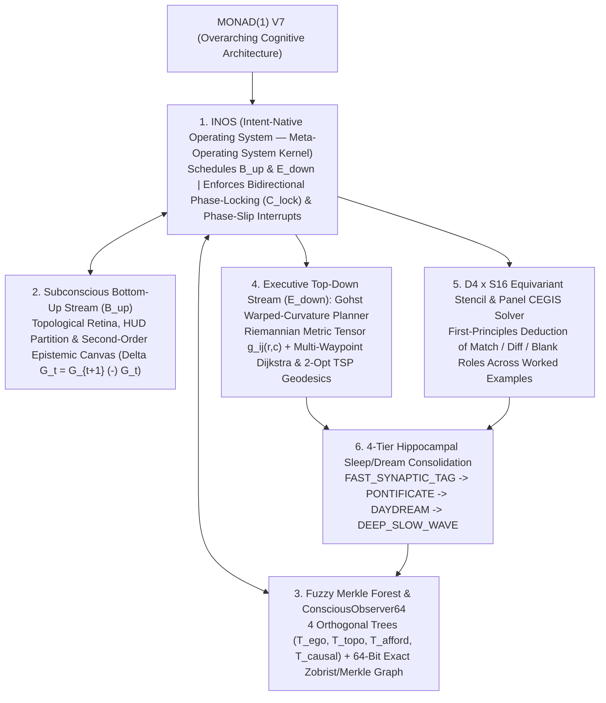

# Monad(1) V7 — System Architecture Specification

**Author:** Kyle W. Luecke (`Drift Bound Labs`)  
**Associated Paper:** [`MONAD_1_V7_PAPER.pdf`](MONAD_1_V7_PAPER.pdf) ([Markdown Source](MONAD_1_V7_PAPER.md))

---

## 1. Architectural Hierarchy of Monad(1) V7

**Monad(1) V7** is the overarching interactive reasoning system engineered for $64 \times 64$ discrete visual environments (**ARC-AGI-3**). Rather than relying on open-loop sequence generation or hardcoded environment identifiers, **Monad(1) V7** coordinates six tightly integrated subsystems under a single unified umbrella:

---

## 2. Constituent Subsystems Under Monad(1) V7

### 2.1 `INOS` (Intent-Native Operating System — The Meta-Operating System Kernel)
Within **Monad(1) V7**, **`INOS`** serves as the meta-operating system that schedules, gates, and phase-locks two counter-propagating evaluation streams:
- **Bidirectional Phase-Locked Memory Binding:** When the ascending bottom-up structural sketch $\tilde{\sigma}_{\uparrow}(\mathbf{G}_t)$ from $\mathcal{B}_{\uparrow}$ and the descending top-down sketch $\tilde{\sigma}_{\downarrow}(m; \Gamma)$ from $\mathcal{E}_{\downarrow}$ achieve phase coherence ($\mathcal{C}_{\text{lock}} \ge \theta_{\text{lock}}$) with zero empirical falsification ($\Delta_{\text{falsify}} = 0$), `INOS` locks onto memory schema $m$ in $O(K \log N)$ bitboard operations.
- **Phase-Slip Interrupts:** If an environment inverts directional controls mid-episode (`ACTION1 <-> ACTION2`, `ACTION3 <-> ACTION4`) or alters mechanics across level boundaries, $\Delta_{\text{falsify}} > 0$ triggers an `INOS` Phase-Slip Interrupt that quarantines the falsified edge and re-locks the new control or dihedral gauge frame within $\le 2$ actions.

### 2.2 Subconscious Bottom-Up Evaluation ($\mathcal{B}_{\uparrow}$) & Second-Order Epistemic Canvas
On every step $t$, the bottom-up stream $\mathcal{B}_{\uparrow}$ executes an eliminative sensory pass over the $64 \times 64$ grid $\mathbf{G}_t$:
- **Playfield vs. HUD Separation:** Detects full-span horizontal and vertical divider bars and peripheral telemetry strips, partitioning the grid into $\Omega = \Omega_{\text{playfield}} \sqcup \Omega_{\text{HUD}}$.
- **Topological Component Extraction:** Extracts 8-connected components $\mathcal{C}(\mathbf{G}_t)$, computing bounding boxes, pixel mass, Euler hole counts $\chi(O_m)$, and canonical $D_4$ shape masks.
- **Second-Order Epistemic Canvas (`_EpistemicCanvas`):** Computes the live action-transition differential $\Delta \mathbf{G}_t = \mathbf{G}_{t+1} \ominus \mathbf{G}_t$ to infer the controllable ego-avatar's kinematic displacement vector $\hat{\mathbf{v}}_t(a)$, passable background colors, solid wall colors, and interactive switch/portal couplings.

### 2.3 Fuzzy Merkle Forest & 64-Bit Associative Graph (`ConsciousObserver64`)
Every observed state is indexed by a 128-bit **Dual Signature** $\Sigma(v) = (h_{\text{exact}}(v), \tilde{\sigma}_{\text{fuzzy}}(v)) \in \mathbb{Z}_{2^{64}} \times \mathbb{F}_2^{64}$:
1. **Exact 64-Bit State Digest (`ConsciousObserver64`):** Packs `(avatar_y, avatar_x, level_idx, n_objects, Zobrist_playfield_hash)` into a single `uint64` vertex in the directed transition multigraph $\mathcal{G}_t = (\mathcal{V}_t, \mathcal{E}_t)$. Zero-effect actions receive $\Delta \Phi = +50.0$, 2-cycle oscillations receive $\Delta \Phi = +15.0$, and life-loss/reset hazards receive $\Delta \Phi = +500.0$.
2. **4-Tree Fuzzy Merkle Forest ($\mathcal{F} = \{\mathcal{T}_{\text{ego}}, \mathcal{T}_{\text{topo}}, \mathcal{T}_{\text{afford}}, \mathcal{T}_{\text{causal}}\}$):** Indexes 64-bit Charikar SimHash sketches across four orthogonal structural axes so analogous sub-trajectories can be retrieved via single-cycle hardware `POPCNT` Hamming distance queries.

### 2.4 Gohst Warped-Curvature Metric Tensor & 2-Opt TSP Geodesic Planner
Navigation over $\Omega_{\text{playfield}}$ is formulated on a discrete Riemannian manifold with conformal metric weight $w(r, c)$:
- Impassable walls: $w(r, c) = +\infty$
- Verified hazards/traps: $w(r, c) = 10^4$
- Traversable corridors: $w(r, c) = 1.0$
- Unvisited affordance targets (keys, switches, portals, goal cells): $w(r, c) = 10^{-2}$

Multi-target subgoal tours are solved via multi-source Dijkstra over $w(r, c)$ followed by exact permutation search ($K \le 7$) or iterative **2-Opt Traveling Salesperson geodesic optimization** ($K > 7$).

### 2.5 First-Principles $D_4 \times S_{16}$ Equivariant Stencil & Panel CEGIS Solver
For symbolic reference-panel and coordinate-clicking tasks (`ft09`, `vc33`, `lp85`, `sp80`), **Monad(1) V7** performs palette-invariant role deduction:
- Partitioning worked example panels $(\mathbf{Q}_{00}, \mathbf{Q}_{01}, \mathbf{Q}_{10})$ and target test panel $\mathbf{Q}_{11}$, the solver algebraically abduces `match_c`, `diff_c`, and `blank_c` roles invariant under any 16-color permutation $\rho \in S_{16}$ and dihedral symmetry $g \in D_4$.
- Bordered option selectors are verified by requiring a closed 1-pixel contrasting perimeter border around a distinct interior background, preventing uniform playfields beneath a top HUD bar from being misclassified as selector frames.

### 2.6 Four-Tier Hippocampal Sleep/Dream Consolidation (`STM_SHARD_00` $\to$ LTM)
Experience is consolidated from Hippocampal Short-Term Memory (`STM_SHARD_00`) into the Fuzzy Merkle Forest across four harmonic bands:
- **Tier 1 (`FAST_SYNAPTIC_TAG`):** Per-step edge penalty updates ($\Delta \Phi$) and leaf insertion.
- **Tier 2 (`PONTIFICATE`):** Cycle-free BFS rollback to the highest-utility unvisited frontier vertex upon local stall ($\ge 6$ steps).
- **Tier 3 (`DAYDREAM`):** Loop-erased geodesic trajectory distillation at level completion (`levels_completed` increments).
- **Tier 4 (`DEEP_SLOW_WAVE`):** Cross-level subtree merging into canonical $O(1)$ macro-affordance policies.
