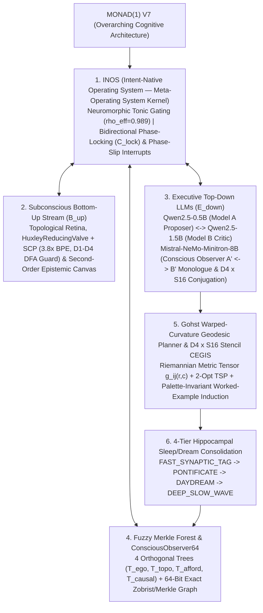

# Monad(1) V7 — System Architecture Specification

**Author:** Kyle W. Luecke (`Drift Bound Labs`)  
**Associated Paper:** [`MONAD_1_V7_PAPER.pdf`](MONAD_1_V7_PAPER.pdf) ([Markdown Source](MONAD_1_V7_PAPER.md))

---

## 1. Architectural Hierarchy of Monad(1) V7

**Monad(1) V7** is the overarching neuro-symbolic reasoning architecture engineered for $64 \times 64$ discrete visual environments (**ARC-AGI-3**). Rather than relying on unconstrained cloud LLM token generation or hardcoded environment identifiers, **Monad(1) V7** embeds local **Qwen (`Qwen2.5-0.5B-Instruct` & `Qwen2.5-1.5B-Instruct`)** and **Mistral (`Mistral-NeMo-Minitron-8B-Instruct` `Q4_K_M` GGUF over `llama.cpp` Vulkan/AVX2)** language models inside the **Intent-Native Operating System (`INOS`)** meta-operating system kernel:

---

## 2. Constituent Subsystems Under Monad(1) V7

### 2.1 `INOS` (Intent-Native Operating System — The Meta-Operating System Kernel)
Within **Monad(1) V7**, **`INOS`** serves as the meta-operating system that schedules, gates, and phase-locks the subconscious bottom-up stream ($\mathcal{B}_{\uparrow}$) and the executive top-down LLM/symbolic stream ($\mathcal{E}_{\downarrow}$):
- **Neuromorphic Tonic Gating ($\rho_{\text{eff}} = 0.989$):** Routes each step across three tiers according to tonic arousal $\text{tone}_t$:
  1. `tone < 0.25` (`RouteDeterministic`): Executes phase-locked $O(1)$ `ConsciousObserver64` / Fuzzy Merkle Forest macro-policies at $0.0\text{ ms}$ LLM overhead.
  2. `0.25 <= tone < 0.65` (`RouteSingleModel`): Invokes local **`Qwen2.5-0.5B-Instruct`** (Model A Proposer) conditioned on `SCP`-compressed observations and recalled Fuzzy Merkle Forest shards.
  3. `tone >= 0.65` (`RouteDualModelReview`): Mobilizes **`Qwen2.5-1.5B-Instruct`** (Model B Deductive Critic) and **`Mistral-NeMo-Minitron-8B-Instruct`** (`KMoshConsciousObserver`) to audit broken premises and synthesize top-down $D_4 \times S_{16}$ conjugations.
- **Bidirectional Phase-Locked Memory Binding & Phase-Slip Interrupts:** When $\mathcal{B}_{\uparrow}$ and $\mathcal{E}_{\downarrow}$ achieve phase coherence ($\mathcal{C}_{\text{lock}} \ge \theta_{\text{lock}}$) with zero empirical falsification ($\Delta_{\text{falsify}} = 0$), `INOS` locks onto memory schema $m$ in $O(K \log N)$ bitboard operations. If a mid-episode control inversion (`ACTION1 <-> ACTION2`) or mechanic shift violates expectation ($\Delta_{\text{falsify}} > 0$), an `INOS` Phase-Slip Interrupt quarantines the falsified edge and re-locks the gauge frame within $\le 2$ actions.

### 2.2 Local `Qwen2.5` ($0.5\text{B} \leftrightarrow 1.5\text{B}$) Bicameral Inpainting & `Mistral-NeMo-Minitron-8B` Conscious Observer
- **Bicameral `Qwen2.5` Loop:** `Qwen2.5-0.5B-Instruct` projects candidate views $\mathcal{V}_t$, while `Qwen2.5-1.5B-Instruct` computes the residual error mask $M_t(r,c) \in \{0,1\}$, freezes verified regions ($M_t=0$), extracts Dirichlet boundary conditions $\partial M_t$, and drives conditioned latent inpainting on $M_t=1$.
- **`Mistral-NeMo-Minitron-8B-Instruct` (`Q4_K_M` GGUF over `llama.cpp` Vulkan/AVX2):** Positioned at the terminal end of the `HuxleyReducingValve`, `Mistral-NeMo-8B` conducts a unified first-person intra-psychic monologue ($A' \leftrightarrow B'$) within one continuous self, diagnosing rotated orientations or permuted color roles and emitting a `DownwardCausalDirective` ($\tilde{f}_{g, \rho} = g^{-1} \circ f_{\rho} \circ g$).

### 2.3 Subconscious Bottom-Up Evaluation ($\mathcal{B}_{\uparrow}$), `SCP`, & Second-Order Epistemic Canvas
- **Semantic Compression Protocol (`SCP`) & `HuxleyReducingValve`:** Compresses $10^{900}$ raw grid states by $3.1\times\text{–}3.8\times$ BPE tokens and enforces a 4-rung DFA efferent guard ladder ($D_1\text{–}D_4$) guaranteeing $0\%$ syntactically invalid actions.
- **Playfield vs. HUD Separation & Component Extraction:** Separates $\Omega = \Omega_{\text{playfield}} \sqcup \Omega_{\text{HUD}}$ and extracts 8-connected components $\mathcal{C}(\mathbf{G}_t)$ with Euler hole counts $\chi(O_m)$ and canonical $D_4$ shape masks.
- **Second-Order Epistemic Canvas (`_EpistemicCanvas`):** Computes the live action-transition differential $\Delta \mathbf{G}_t = \mathbf{G}_{t+1} \ominus \mathbf{G}_t$ to infer the controllable ego-avatar's kinematic displacement vector $\hat{\mathbf{v}}_t(a)$, passable background colors, solid wall colors, and interactive switch/portal couplings.

### 2.4 Fuzzy Merkle Forest & 64-Bit Associative Graph (`ConsciousObserver64`)
Every observed state is indexed by a 128-bit **Dual Signature** $\Sigma(v) = (h_{\text{exact}}(v), \tilde{\sigma}_{\text{fuzzy}}(v)) \in \mathbb{Z}_{2^{64}} \times \mathbb{F}_2^{64}$:
1. **Exact 64-Bit State Digest (`ConsciousObserver64`):** Packs `(avatar_y, avatar_x, level_idx, n_objects, Zobrist_playfield_hash)` into a single `uint64` vertex in the directed transition multigraph $\mathcal{G}_t = (\mathcal{V}_t, \mathcal{E}_t)$. Zero-effect actions receive $\Delta \Phi = +50.0$, 2-cycle oscillations receive $\Delta \Phi = +15.0$, and life-loss/reset hazards receive $\Delta \Phi = +500.0$.
2. **4-Tree Fuzzy Merkle Forest ($\mathcal{F} = \{\mathcal{T}_{\text{ego}}, \mathcal{T}_{\text{topo}}, \mathcal{T}_{\text{afford}}, \mathcal{T}_{\text{causal}}\}$):** Indexes 64-bit Charikar SimHash sketches across four orthogonal structural axes so analogous sub-trajectories can be retrieved via single-cycle hardware `POPCNT` Hamming distance queries, expanding effective LLM context by $>1,000\times$.

### 2.5 Gohst Warped-Curvature Metric Tensor & $D_4 \times S_{16}$ Equivariant Stencil CEGIS
- **Warped-Curvature Riemannian Geodesics:** Assigns conformal metric weights $w(r, c) \in \{+\infty, 10^4, 1.0, 10^{-2}\}$ to walls, falsified hazards, passable corridors, and active subgoals, solving multi-waypoint tours via Dijkstra and **2-Opt Traveling Salesperson geodesic optimization**.
- **First-Principles $D_4 \times S_{16}$ Stencil/Panel CEGIS:** Intersects intra-tile homogeneity constraints across worked example quadrants $(\mathbf{Q}_{00}, \mathbf{Q}_{01}, \mathbf{Q}_{10})$ to abduce `match_c`, `diff_c`, and `blank_c` roles under arbitrary 16-color permutations $\rho \in S_{16}$ and validates bordered $8 \times 8$ option frames via perimeter contrast checks.

### 2.6 Four-Tier Hippocampal Sleep/Dream Consolidation (`STM_SHARD_00` $\to$ LTM)
Experience is consolidated from Hippocampal Short-Term Memory (`STM_SHARD_00`) into the Fuzzy Merkle Forest across four harmonic bands:
- **Tier 1 (`FAST_SYNAPTIC_TAG`):** Per-step edge penalty updates ($\Delta \Phi$) and leaf insertion.
- **Tier 2 (`PONTIFICATE`):** Cycle-free BFS rollback to the highest-utility unvisited frontier vertex upon local stall ($\ge 6$ steps).
- **Tier 3 (`DAYDREAM`):** Loop-erased geodesic trajectory distillation at level completion (`levels_completed` increments).
- **Tier 4 (`DEEP_SLOW_WAVE`):** Cross-level subtree merging into canonical $O(1)$ macro-affordance policies.
