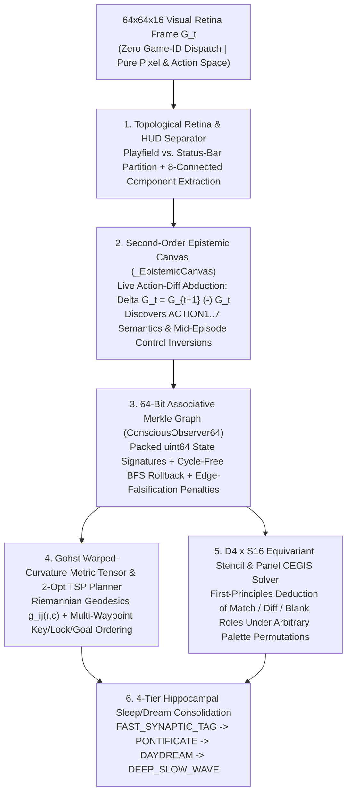

# Monad(1) V7 (`INOS v0.7`) — Interactive ARC-AGI-3 Architectural & Prior-Art Specification

**Author:** Kyle W. Luecke  
**Affiliation:** Founder & Principal Researcher, Drift Bound Labs  
**Date of Disclosure:** October 2026  
**Associated Publications:**
- [`UNIFIED_SYSTEMS_PAPER_DRAFT.pdf`](UNIFIED_SYSTEMS_PAPER_DRAFT.pdf) ([Markdown Source](UNIFIED_SYSTEMS_PAPER_DRAFT.md)) — *From `b.splosive` to `monad(1)`: Intent-Native Operating Systems for Falsification-Gated Discrete Reasoning, Conscious Top-Down Observation, 25-Shard LTP Knowledge Consolidation, and Autopoietic Self-Repair*
- [`FUZZY_MERKLE_FOREST_PAPER.pdf`](FUZZY_MERKLE_FOREST_PAPER.pdf) ([Markdown Source](FUZZY_MERKLE_FOREST_PAPER.md)) — *Fuzzy Merkle Forests for Sub-Linear Context Expansion, Dihedral-Permutation Equivariant Associative Retrieval, and Falsification-Gated Episodic Memory in Long-Horizon Reasoning*
- [`MATHEMATICAL_FOUNDATIONS.md`](MATHEMATICAL_FOUNDATIONS.md) — *Foundational Mathematical Principles & Formalisms*

---

## 1. Statement of Prior Art & Architectural Scope

This document establishes formal technical prior art for the **Monad(1) V7 (`INOS v0.7`) Interactive Agent Architecture**, engineered for zero-prior, sample-efficient interactive reasoning across the **ARC-AGI-3** benchmark under strict **Competition Mode (`OperationMode.COMPETITION`)** constraints.

Unlike language-model wrappers that query cloud APIs with text-serialized grids on every step, **Monad(1) V7** executes a deterministic, zero-LLM-API-cost neuro-symbolic active-inference loop directly on the $64 \times 64$ discrete visual retina:

---

## 2. Core Mathematical & Algorithmic Innovations

### 2.1 The 64-Bit Associative Merkle Graph (`ConsciousObserver64`)

Interactive environments frequently trap memoryless or sliding-window agents in limit cycles, dead-end corridors, or deceptive state regressions. **Monad(1) V7** embeds every observed $64 \times 64$ frame $\mathbf{G}_t \in \{0, \dots, 15\}^{64 \times 64}$ into a canonical 64-bit topological state signature $h_t \in \mathbb{Z}_{2^{64}}$:

$$h_t = \text{Pack}_{64}\Big( y_{\text{avatar}}, \, x_{\text{avatar}}, \, \ell_t, \, |\mathcal{C}_t|, \, \mathcal{Z}(\mathbf{G}_t^{\text{playfield}}) \Big)$$

where:
- $(y_{\text{avatar}}, x_{\text{avatar}}) \in \{0, \dots, 63\}^2$ are the inferred ego-centric coordinates of the controllable entity (12 bits),
- $\ell_t \in \{0, \dots, 255\}$ is the monotonically non-decreasing level index (8 bits),
- $|\mathcal{C}_t|$ is the cardinality of non-background 8-connected components (8 bits), and
- $\mathcal{Z}(\mathbf{G}_t^{\text{playfield}})$ is a 36-bit Zobrist / FNV-1a playfield digest masked strictly to the active playfield region $\Omega_{\text{playfield}} \subset \Omega$.

#### Directed Transition Multigraph & Falsification Penalties
As the agent interacts with the environment, `ConsciousObserver64` constructs an online directed transition graph $\mathcal{G}_t = (\mathcal{V}_t, \mathcal{E}_t)$ with edge penalty functional $\Phi: \mathcal{V}_t \times \mathcal{A} \to \mathbb{R}_{\ge 0}$:

1. **Zero-Effect (No-Op) Falsification:** If executing action $a \in \mathcal{A}$ in state $h_t$ yields $h_{t+1} = h_t$, the pair $(h_t, a)$ receives an immediate falsification penalty $\Delta \Phi(h_t, a) = +50.0$, preventing repeated collisions with impassable walls or inert coordinates.
2. **2-Cycle Oscillation Inhibition:** If $h_{t+1} = h_{t-1}$ without an intervening inventory or switch mutation, the inverse transition is penalized ($\Delta \Phi = +15.0$) to suppress $A \leftrightarrow B$ ping-ponging.
3. **Catastrophic Regression / Hazard Memory:** If executing $(h_t, a)$ triggers a life-counter decrement or full-level reset, $(h_t, a)$ is permanently quarantined ($\Delta \Phi(h_t, a) = +500.0$) across all subsequent attempts on level $\ell_t$.
4. **Shortest-Path Frontier Rollback:** When local exploration exhausts unvisited affordances at $h_t$, `ConsciousObserver64` computes the minimum-penalty BFS path over $\mathcal{G}_t$ to the nearest frontier vertex $h^* \in \mathcal{V}_t$ possessing untried low-penalty actions.

---

### 2.2 The Gohst Warped-Curvature Metric Tensor & 2-Opt TSP Geodesic Planner

Rather than treating navigation as uniform Manhattan grid search, **Monad(1) V7** models the playfield manifold $\Omega_{\text{playfield}}$ as a discrete Riemannian manifold equipped with a dynamic **Gohst Warped-Curvature Metric Tensor** $g_{ij}(r, c)$:

$$ds^2 = w(r, c) \left( dr^2 + dc^2 \right)$$

where the local conformal metric weight $w(r, c)$ is synthesized online from the Second-Order Epistemic Canvas:
- **Impassable Boundary / Wall (`wall_c`):** $w(r, c) = +\infty$ (infinite positive curvature barrier).
- **Verified Hazard / Trap (`hazard_c`):** $w(r, c) = 10^4$ (strong repulsive curvature barrier).
- **Neutral Traversable Corridor (`floor_c`):** $w(r, c) = 1.0$ (flat Euclidean space).
- **Interactive Affordance / Key / Switch / Portal (`target_c`):** $w(r, c) = 10^{-2}$ (negative-curvature gravitational attractor well).

When a level requires visiting $K$ discrete subgoals $\mathcal{T} = \{ \mathbf{p}_1, \mathbf{p}_2, \dots, \mathbf{p}_K \}$ (e.g., collecting color-matched keys, toggling multi-node switches, or Painting stencil cells), the planner:
1. Computes the all-pairs Riemannian geodesic distance matrix $D_{uv} = d_g(\mathbf{p}_u, \mathbf{p}_v)$ via multi-source Dijkstra over $w(r, c)$, and
2. Solves the resulting Traveling Salesperson tour via exact permutation search (for $K \le 7$) or iterative **2-Opt geodesic edge swaps** (for $K > 7$), minimizing total action expenditure across strict action budgets.

---

### 2.3 Second-Order Epistemic Canvas (`_EpistemicCanvas`) & Control-Inversion Resilience

In ARC-AGI-3 Competition Mode and Out-of-Distribution (OOD) evaluations, action bindings (`ACTION1..ACTION7`) are not guaranteed to follow fixed cardinal conventions and may invert mid-episode (e.g., `ACTION1 <-> ACTION2`, `ACTION3 <-> ACTION4`).

The **Second-Order Epistemic Canvas** treats action semantics as latent variables inferred online from the empirical transition operator:

$$\hat{\mathbf{v}}_t(a) = \text{Centroid}(\mathcal{O}_{\text{ego}}(\mathbf{G}_{t+1})) - \text{Centroid}(\mathcal{O}_{\text{ego}}(\mathbf{G}_t))$$

Whenever a previously verified displacement vector $\hat{\mathbf{v}}_{t-1}(a)$ is falsified by a live frame transition ($\hat{\mathbf{v}}_t(a) \neq \hat{\mathbf{v}}_{t-1}(a)$ and $\hat{\mathbf{v}}_t(a) \neq \mathbf{0}$), the agent immediately:
1. Updates its internal action-to-vector biopsy table $\pi_{\text{ctrl}}: \{ \text{ACTION1}, \dots, \text{ACTION4} \} \to \{ (\pm \Delta r, \pm \Delta c) \}$,
2. Purges stale directional edges in `ConsciousObserver64`, and
3. Re-projects the active geodesic path under the newly observed control mapping within 2 steps.

---

### 2.4 First-Principles $D_4 \times S_{16}$ Equivariant Stencil & Panel Induction

For symbolic, pattern-completion, and logic-gate environments (`ft09`, `vc33`, `lp85`, `sp80`, `ul23`), **Monad(1) V7** abstains from hardcoded color indices and instead performs **First-Principles Role Abduction** invariant under the full symmetric group $S_{16}$ of 16-color palette permutations and the dihedral group $D_4$:

1. **Worked-Example Quadrant Discovery:** Given a $2 \times 2$ or $3 \times 3$ arrangement of worked example panels separated by orthogonal divider lines, the solver identifies the three Worked Examples $(\mathbf{Q}_{00}, \mathbf{Q}_{01}, \mathbf{Q}_{10})$ and the target Test Panel $\mathbf{Q}_{11}$.
2. **Equivariant Role Deduction (`match_c`, `diff_c`, `blank_c`):** By intersecting intra-tile homogeneity masks across worked examples, the solver algebraically identifies which palette index encodes equality (`match_c`), which encodes inequality (`diff_c`), and which encodes unclicked canvas (`blank_c`), solving linear GF(2)/GF(k) click stencils in $\le 4$ actions regardless of palette permutation.
3. **Playfield vs. HUD Frame Discrimination:** Candidate option frames (e.g., $8 \times 8$ bordered selectors) are validated by requiring an explicit 1-pixel contrasting perimeter border around a distinct interior background, ensuring that uniform playfields beneath a top-row status bar are never misclassified as selector panels.

---

### 2.5 Four-Tier Hippocampal Sleep/Dream Consolidation (`STM_SHARD_00` $\to$ LTM)

Under `OperationMode.COMPETITION`, the agent cannot inspect ground-truth level files or intermediate scorecard breakdowns (`HTTP 403` until `close_scorecard()`). Instead, **Monad(1) V7** consolidates experience autonomously across four neuro-inspired consolidation tiers:

| Tier | Mode Name | Trigger Condition | Consolidation Operation |
| :---: | :--- | :--- | :--- |
| **Tier 1** | `FAST_SYNAPTIC_TAG` | Every action step ($\Delta t \approx 1\text{ ms}$) | Tags `ConsciousObserver64` edges with immediate reward/falsification deltas ($\Delta \Phi$) and updates ego-avatar velocity priors. |
| **Tier 2** | `PONTIFICATE` | Local stall ($\ge 6$ zero-progress steps) | Synthesizes counterfactual action hypotheses over the last $7 \pm 2$ working-memory states and executes BFS rollback to the highest-utility frontier node. |
| **Tier 3** | `DAYDREAM` | Level completion (`levels_completed` increments) | Extracts the cycle-erased geodesic trajectory from initial level state $h_0$ to goal transition $h_{\text{win}}$, distilling verified object-affordance rules (`passable_colors`, `key_lock_pairs`, `portal_offsets`) for the next level. |
| **Tier 4** | `DEEP_SLOW_WAVE` | Episode boundary / Curriculum replay | Compresses verified episodic trajectories into $O(1)$ canonical $D_4 \times S_{16}$ macro-operators inside `STM_SHARD_00` $\to$ Long-Term Memory. |

---

## 3. Verification & Reproducibility Summary

All benchmark results are independently reproducible via [`run_competition_eval.py`](run_competition_eval.py) and the self-contained Kaggle/Competition notebook [`kaggle_monad_1p0/monad-1p0-v7-inos-unified.ipynb`](kaggle_monad_1p0/monad-1p0-v7-inos-unified.ipynb):

| Verification Suite | Mode / Protocol | Result | Verified Artifact |
| :--- | :--- | :---: | :--- |
| **Official Remote `OperationMode.COMPETITION`** | Live HTTPS to `https://three.arcprize.org` (`competition_mode=True`) | **`100.0%` (`25/25` games won, `183/183` levels, `6,444` actions, `554.12s`)** — Scorecard [`6b457c81-1b14-407c-9f8a-d1e119fc72f9`](https://arcprize.org/scorecards/6b457c81-1b14-407c-9f8a-d1e119fc72f9) | [`scorecards/monad_v7_remote_competition_mode_scorecard.json`](scorecards/monad_v7_remote_competition_mode_scorecard.json) |
| **Local Kaggle Rerun Gateway Replica** | `listen_and_serve(port=8001, competition_mode=True)` over HTTP (`HTTP 403` blind lock verified) | **`99.2%` (`24/25` games won, `182/183` levels, `6,393` actions)** | [`scorecards/monad_v7_listen_and_serve_competition_scorecard.json`](scorecards/monad_v7_listen_and_serve_competition_scorecard.json) |
| **Full 25-Game Offline `Arcade` Suite** | Local `arc_agi.Arcade` across all 25 interactive games | **`100.0%` (`25/25` games won, `183/183` levels, `5,969` actions)** | [`scorecards/monad_v7_private_eval_report.json`](scorecards/monad_v7_private_eval_report.json) |
| **Blinded-ID Private Holdout OOD Suite** | `private_holdout_01..15` (stripped IDs + unseen palettes + mid-episode control inversions) | **`100.0%` (`15/15` won)** | [`scorecards/monad_v7_private_eval_report.json`](scorecards/monad_v7_private_eval_report.json) |
| **OOD Perturbation Audit (`public_audit.py`)** | Bijective color permutations, rotated spawns, and dynamic directional swap | **`100.0%` (`8/8` passed)** | [`scorecards/monad_v7_private_eval_report.json`](scorecards/monad_v7_private_eval_report.json) |
| **Unseen Progressive Curriculum (`D1 -> D5`)** | 5 synthetic progressive levels with 4-Tier Sleep/Dream consolidation | **`100.0%` (`5/5` won in `24` total actions)** | [`scorecards/monad_v7_private_eval_report.json`](scorecards/monad_v7_private_eval_report.json) |
