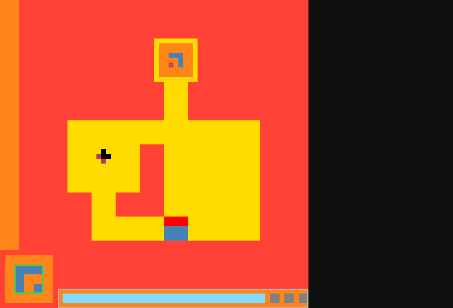
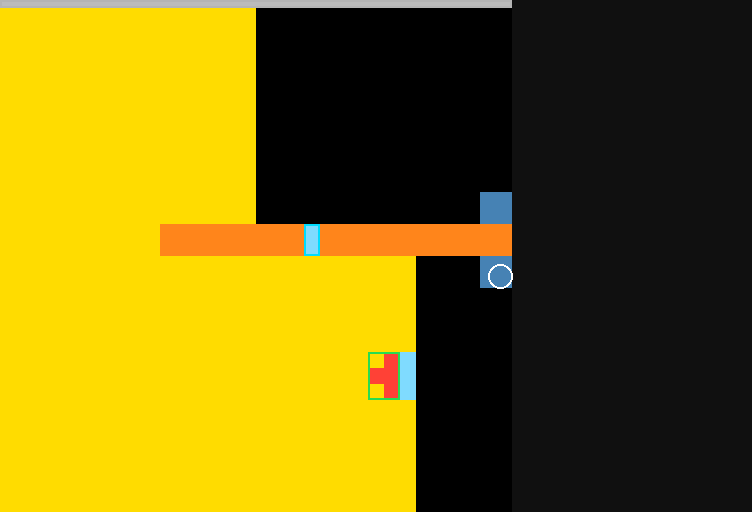

# Diagnosis: why a control plan does not clear level 1

This is not a score. Solvers were off on the coordination path. `PYTHONHASHSEED=0`. The 300s cap was off. Ground truth below comes from the level-complete event on a solvers-on trace and was not given to the agent.

Two games: `ls20` (d-pad only) and `vc33` (click only). The first stage that breaks is perception of the goal, and of which object is controllable. Later stages never receive the objects that actually finish the level. A hand-fed plan does not clear `ls20`. It clears `vc33` only when the click anchor is replaced with the pump the role layer did not select.

## What actually finishes level 1

`ls20`. Legal actions are 1–4. A solvers-on trace clears level 1 in 13 actions: left, left, left, up ×4, right ×3, up ×3. The cells that move are a short horizontal token (a 5×2 rect) at the mouth of the corridor. The last up changes the frame and `levels_completed` becomes 1. The exit is up the corridor. It is not the hollow icon in the bottom-left HUD.

`vc33`. Legal actions are click only. The same trace clears level 1 by clicking (62, 34) three times. That point sits on a pump button. The first two clicks move the columns and do not complete the level. The third click does.

## Stage verdicts

| Stage | ls20 | vc33 |
| --- | --- | --- |
| 1. Perception | broken | broken |
| 2. Goal | broken | broken |
| 3. Thought stream | partial | broken |
| 4. Executive | partial | partial |
| 5. Plan to action | broken | broken |
| 6. Feedback | broken | partial |

### 1. Perception

`ls20`, real legal set `[1, 2, 3, 4]`. Roles on the first frame: receptor, reference, wall, avatar, goal. Receptor, reference, and goal are the same hollow rect, click (4, 57), which is the HUD icon. Wall is the long HUD bar. Avatar is an ellipse geom `(4, 1, 1)`, and that geom matches three different specks, including one at (35, 13). The token that actually translates under the d-pad is the 5×2 rect at about (34, 45).



After one real move, `note_effect` does retarget avatar to geom `(1, 2, 5)`, the token that moved. Goal stays the HUD icon for the rest of the attempt.

`vc33`, legal set `[6]`. No avatar, which matches a click-only frame. Roles: receptor, reference, wall, clickable, goal. Goal and reference are again the same hollow rect, click (48, 46), a small panel. Wall is the top HUD line. Clickable is the smallest rect, and the anchor expansion will use first is (38, 29). The pump at (62, 34) is in the affordance list as a later anchor, (61, 33), and it is not the bound object. The white ring in the figure is that winning click, drawn for this diagnosis. It is not a role box.



### 2. Goal

Goal discovery and goal memory were off, and the agent stored no goal hypothesis (`m2_goal_hypothesis` is null). The only goal is the role from stage 1. On both games that role is a copy of the reference shape. On `vc33` the first prompt also rebinds goal from schema S0, stored on the previous `ls20` episode: "the goal rebound to hollow…". Nothing compares that label to the level-complete event. For `ls20` the true completion is reaching the end of the corridor. For `vc33` it is three presses of one pump. Neither is the hollow rect the stack calls goal.

### 3. Thought stream

The plan prompt is role names, a primitive line, a menu, and a theory fragment. It does not say which shape moved, where the exit is, or what the last action did.

Literal plan prompt on `ls20` after three discover steps:

```
Roles: receptor, reference, wall, avatar, movable, goal. Primitives: convey binds avatar,movable,goal translate(role=movable, dir=up) conf 0.5; align binds avatar,receptor match(object=avatar, reference=reference) conf 1.0; route binds avatar,wall translate(role=avatar, dir=up) conf 1.0; assemble binds movable,receptor contact(roleA=movable, roleB=receptor) conf 1.0. Menu: 0 simple#1 | 1 simple#2 | 2 simple#3 | 3 simple#4. Write the plan for this level. Theory: why.
```

The discover prompt's `[avatar]` line is `ELLIPSE … click=7,59`, a HUD speck, while `[solver]` still proposes a floor-paint direction. Qwen A' and B' answer with `SIMPLE` actions. That is enough for a d-pad game and useless for telling the executive where the corridor goes.

On `vc33` the same stream says `avatar unresolved` and then both Qwen models still emit `SIMPLE 4` and `SIMPLE 3` with binding `avatar,goal`. The menu is only `click(clickable#n)`. The information needed to press the pump three times is not in the prompt.

### 4. Executive

Given those inputs, Mistral writes a grammatical plan and then does not change it.

`ls20` plan, repeated on the initial write and on all four replans:

```
{ "goal": "REACH", "steps": [
  {"primitive": "approach", "binding": "avatar,goal", "predicate": "translate", "role": "avatar", "role_b": "goal", "repeat": 4},
  {"primitive": "convey", "binding": "avatar,movable", "predicate": "translate", "role": "movable", "role_b": "avatar", "repeat": 1},
  {"primitive": "align", "binding": "avatar,receptor", "predicate": "match", "role": "avatar", "role_b": "receptor", "repeat": 1}
]}
```

`approach` toward a goal would be the right shape of plan for a corridor, if the goal were the exit. Here the goal is the HUD icon, and the expansion of that plan is "press up".

`vc33` live plans were `cycle_select(clickable,switch,goal) -> toggle(clickable,switch)` and then `assemble(receptor,goal) -> assemble(reference,receptor)`. The first executive JSON on that game was an inhibit of menu item 0 with primitive `hold_gradient`, role `avatar`, `dir` left, on a frame with no d-pad. The grammar still allows that.

Isolation, same 8B, temperature 0, seed 0, plan grammar, hand-written inputs and no game id:

- Corridor description (token, walls, exit, d-pad): `approach(avatar,goal)` repeat 4, then `route(avatar,wall)`. That is the right kind of plan. The model can plan when the roles are true.
- Pump description (switch is the pump, no d-pad, repeated presses finish the level): it starts with `toggle(switch)` repeat 1, then `approach` on a clickable, then another `toggle`, and the JSON is cut off at the token cap. The first step is the right primitive. Repeat 1 does not say "press three times", and `approach` does not belong on a click-only frame.

So the executive is not the first break. With a true description it names `approach`/`route` or `toggle`. With the live description it plans toward the HUD role it was given, and on the click game it still talks about an avatar.

### 5. Plan to action

`suggest_action` for `approach` and `route` returns the first d-pad key, then whatever `progress_axis` was last confirmed. It does not look at the goal's box. A true predicate ends the step immediately. `repeat` is only how many failures are tolerated, so it does not mean "walk this many cells".

Hand-fed plan on `ls20`, no model, no clock, 200 actions: `approach(avatar,goal)` then `route(avatar,wall)`, requeued whenever the script ended. Every action was up (`SIMPLE 1`). Level stayed 0. The winning walk starts with three lefts. The executor did not produce it.

Hand-fed `toggle(switch)` on `vc33`, live anchors, 60 actions: clicks wandered across the menu (`(38, 29)`, `(61, 25)`, `(61, 33)`, and others). Level stayed 0. The same `toggle` plan with the affordance forced to `(62, 34)` cleared level 1 in 4 actions, three of them on that pump. Delivery of a click works. Choosing the pump does not.

A correct plan, hand-fed, does not win `ls20` through this executor. It wins `vc33` only after the anchor is corrected by hand.

### 6. Feedback

On the live `ls20` trace, 8 actions, cap removed (338s): predicate hits 0/7, surprises 7, modes discover ×3, plan, replan ×4, execute 0. Each replan was told `Surprise: predicate false` and returned the same three steps and the same up action. The predicate is right that up-on-the-labeled-avatar is not progress. The replan does not improve, because the prompt has no new object and the planner is free to repeat the failed JSON.

On `vc33`, 8 actions, 322s, 0 levels: one `assemble` step executed with no model call and confirmed `contact(receptor, goal)`. Those two roles are the same panel, so contact can be true while the pump is untouched. A true predicate here is not evidence the level got closer.

## Root cause

The goal role is assigned by copying the reference shape, before any level is completed, and the controllable role is the smallest matching mark rather than the object the winning action moves. Every later stage aims at those labels. The plan language cannot say "left three times" or "this button, three presses", and the expander does not recover that from the frame.

## Fixes, in order

No game-specific code. Not implemented.

1. Do not copy the reference or the HUD hollow rect into the goal role. Leave goal unbound until a completion, or until a hypothesis is checked against a completion. Do not let schema S0 from the previous episode fill that slot.
2. Bind the controllable from the effect. The object that translates under a d-pad action is the avatar. The object under the click that changed the frame is the switch. Do not pick the smallest ellipse or the smallest rect before that evidence exists, and do not keep a geom that matches several objects.
3. Make `approach` and `route` step toward the bound target's box, and turn when the straight cell is blocked. `repeat` has to mean "keep going while this is the step", including after a successful step. One confirmed translate must not retire a walk.
4. Make `toggle` repeat the same anchor for the whole step. Do not walk the menu. The `vc33` control shows that the right anchor, pressed again, clears the level, and the live first anchor does not.
5. On a click-only legal set, drop `SIMPLE`, `avatar`, and `hold_gradient` from the Qwen and executive grammars. The live `vc33` executive emitted `dir: left` against a click menu.
6. A replan has to see the failed predicate, the object that moved, and the action that failed, and it has to be rejected when the new JSON is the same steps. The four `ls20` replans were copies.
